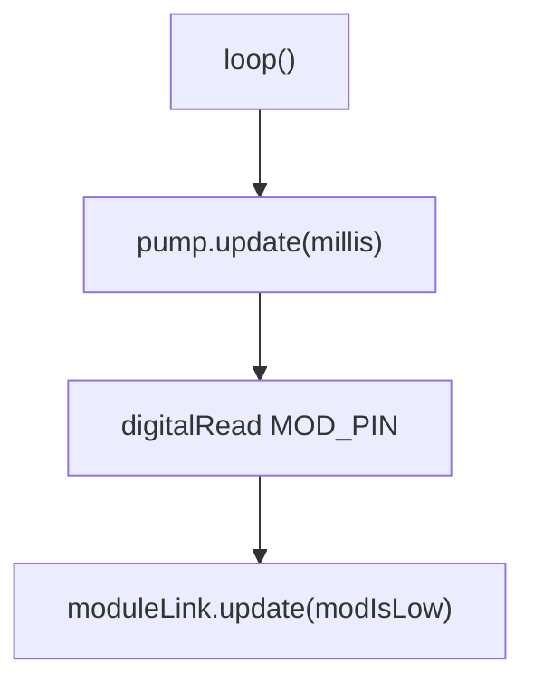

# Firmware architecture

[Home](home.md) · Reference: [Architecture](reference/architecture.md)

## Summary

This firmware runs on the ATtiny1614 pump daughterboard. The ESP32
motherboard is the I2C master. Plugging the board in is enough for the
motherboard to assign an address and identify a pump module.

`src/main.cpp` is the composition root. It owns the pin constants and
the product settings, constructs the adapters, the pump, and the link,
and calls `update()` on the pump and the link.

## Where it sits

Global construction runs before `setup()`. `ModuleLink` registers its
master-write handler there. The slave stays off until `loop()` sees
MOD low.

The motherboard bus is TWI0 on the alternate pins. PA1 is SDA and PA2
is SCL. PB0 and PB1 are the default TWI pins, and this board uses them
for the pump. Arduino `Wire` is that peripheral. `AvrTwi0Slave` calls
`Wire.pins` with `SDA_PIN` and `SCL_PIN` before it listens.

## What it creates

```text
main.cpp
  AvrTwi0Slave    TWI0 adapter for IModuleSlavePort
  AvrPumpPort     enable, nPGD, lamps, and the sense pair
  AvrPumpStore    EEPROM totals
  Pump            switch, fault latch, lamps, and the run record
  ModuleLink      MOD gate, frames, and replies
```

`main.cpp` passes `MODULE_TYPE` and `FIRMWARE_VERSION` into the link,
passes the pump into the link, and passes the port, the store, and
the `PumpConfig` into the pump. Pin numbers and the scale stay in
`main.cpp`.

`lib/Interfaces/` holds `IModuleSlavePort`, `IPumpPort`, `IPumpStore`,
and the copied `ModuleProtocol.h`. `lib/Drivers/` holds the AVR
adapters. `lib/Logic/` holds the pump and the link. Desktop fakes
live in `test/test_desktop/fakes/`.

## One update

`setup()` calls `AvrPumpPort::begin()`, which drives enable and both
lamps low, leaves `nPGD` as an input, and starts the first sense
pair. It then drives `SNS_PIN` low and holds `MOD_PIN` as an input
with pull-up.



`pump.update` runs with interrupts off. The pump commands and the
three record reads call the pump from the TWI interrupt. One
`update` may program a single changed EEPROM byte, which can stall
the CPU for that program.

`loop()` does not block, so a low MOD is seen inside `kModGateMaxMs`.
While the module has no address, MOD low enables `0x0A` and MOD high
disables it. After a valid `SET_ADDRESS`, the link keeps that address
when MOD rises.

## What is stored, and who reads it

Each pass reads `MOD_PIN` and passes that level to the link. The pump
reads `nPGD` and, when a pair is ready, the sense pins on its own
port. The motherboard reads the sense line, which `SNS_PIN` holds low.

The pump stores its phase, the run record, and the on-command time.
Totals that have been saved also live in EEPROM. The link stores the
address and whether it has been assigned. The TWI0 adapter stores the
reply the host clocks out. Those stores are on the
[pump](pump.md), [module link](module-link.md), and
[slave port](slave-port.md) pages.

## See also

- [Architecture reference](reference/architecture.md) — pins, the pass, the image build.
- [Pump](pump.md)
- [Module link](module-link.md)
- [Slave port](slave-port.md)
