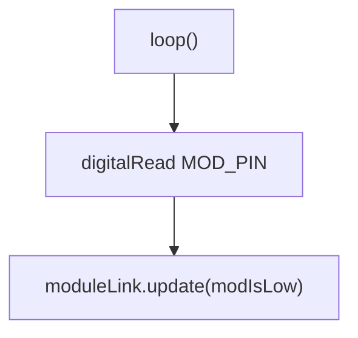

# Firmware architecture

[Home](home.md) · Reference: [Architecture](reference/architecture.md)

## Summary

This firmware runs on the ATtiny1614 pump daughterboard. The ESP32
motherboard is the I2C master. Plugging the board in is enough for the
motherboard to assign an address and identify a pump module.

`src/main.cpp` is the composition root. It owns the pin constants and
the product settings, constructs the adapter and the link, and calls
`update()` on the link.

## Where it sits

Global construction runs before `setup()`. `ModuleLink` registers its
master-write handler there. The slave stays off until `loop()` sees
MOD low.

The motherboard bus is TWI0 on the alternate pins. PA1 is SDA and PA2
is SCL. PB0 and PB1 are the default TWI pins, and this board uses them
for the pump. Arduino `Wire` is that peripheral. `AvrTwi0Slave` calls
`Wire.pins` with `SDA_PIN` and `SCL_PIN` before it listens.

## What it creates

```text
main.cpp
  AvrTwi0Slave    TWI0 adapter for IModuleSlavePort
  ModuleLink      MOD gate, frames, and replies
```

`main.cpp` passes `MODULE_TYPE` and `FIRMWARE_VERSION` into the link,
and passes `SDA_PIN` and `SCL_PIN` into the adapter. Pin numbers stay
in `main.cpp`.

`lib/Interfaces/` holds `IModuleSlavePort` and the copied
`ModuleProtocol.h`. `lib/Drivers/` holds the AVR adapter. `lib/Logic/`
holds the link. Desktop fakes live in `test/test_desktop/fakes/`.

## One update

`setup()` holds `PMP_EN_PIN` low, lights `P_ON_PIN` and `P_WARN_PIN`
for one second, then drives both LEDs low. That pause is temporary.
Delete it once the LEDs are confirmed. It finishes before `SNS_PIN`
goes low, while the host still treats the module as absent. `setup()`
then drives `SNS_PIN` low and holds `MOD_PIN` as an input with pull-up.



`loop()` does not block, so a low MOD is seen inside `kModGateMaxMs`.
While the module has no address, MOD low enables `0x0A` and MOD high
disables it. After a valid `SET_ADDRESS`, the link keeps that address
when MOD rises.

## What is stored, and who reads it

Each pass reads `MOD_PIN` and passes that level to the link. The
motherboard reads the sense line, which `SNS_PIN` holds low.

The link stores the address and whether it has been assigned. The TWI0
adapter stores the reply the host clocks out. Those stores are on the
[module link](module-link.md) and [slave port](slave-port.md) pages.

## See also

- [Architecture reference](reference/architecture.md) — pins, the pass, the image build.
- [Module link](module-link.md)
- [Slave port](slave-port.md)
