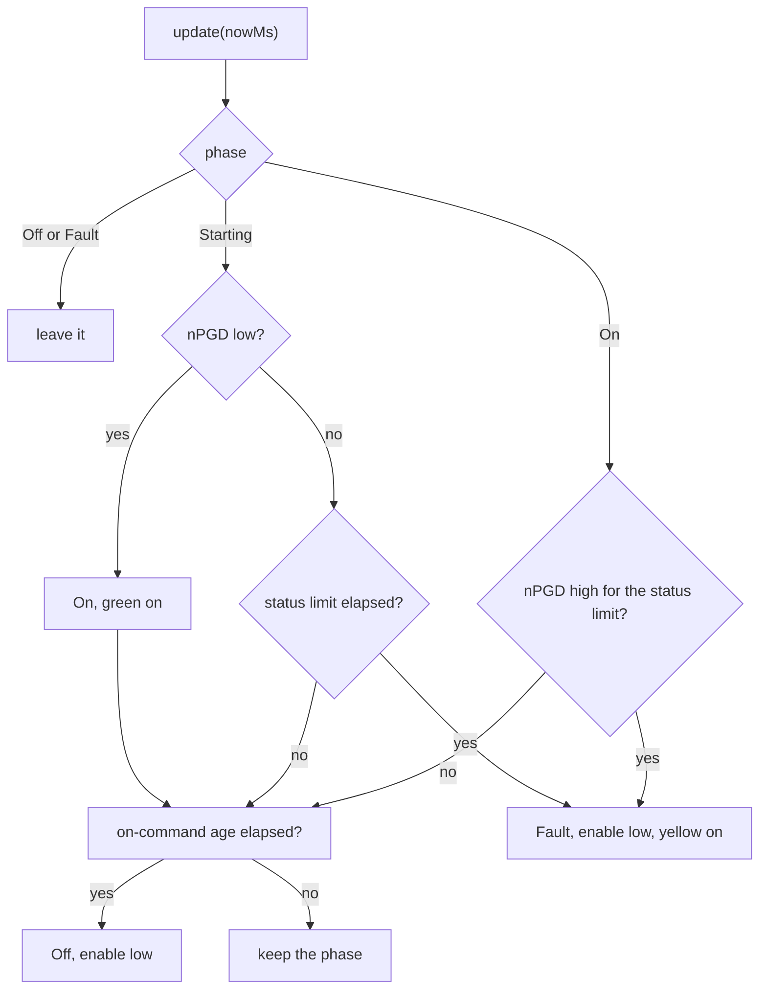

# Pump

[Home](home.md) · Reference: [Pump](reference/pump.md)

## Summary

`Pump` drives the LM5060 and the two lamps. `nPGD` low means the
switch has started. While enable is high, a high that lasts
`PUMP_STATUS_LIMIT_MS` is a fault. A fault stays latched until
`reset()`. The green lamp lights once `nPGD` has gone low. The yellow
lamp lights while the pump is faulted. An on command while the pump
is starting or on stores the command time and leaves enable high.
`update` turns the pump off when that time is `PUMP_COMMAND_LIMIT_MS`
old.

## Where it sits

`main.cpp` constructs `AvrPumpPort` with the pump pins and constructs
`Pump` with that port, `PUMP_STATUS_LIMIT_MS`, and
`PUMP_COMMAND_LIMIT_MS`. It passes the pump
to `ModuleLink`. `loop()` calls `update(millis())` with interrupts
off, because the link calls `turnOn`, `turnOff`, and `reset` from the
TWI interrupt. `setup()` calls `AvrPumpPort::begin()` before it drives
`SNS_PIN`.

## What it creates

```text
Pump
  IPumpPort       enable, nPGD, green lamp, yellow lamp
```

`main.cpp` supplies `AvrPumpPort`. Tests supply `FakePumpPort`.

## One update



`turnOn` from off drives enable high and stores the command time.
If `nPGD` is already low the phase is on. Otherwise it is starting,
which is still reported as on. A later `turnOn` while starting or on
stores the command time again and leaves enable where it is. `turnOff`
from starting or on returns to off. `turnOn` and `turnOff` leave a
fault latched. `reset` returns to off from any phase, and a later
`turnOn` is accepted. When the stored on command is
`PUMP_COMMAND_LIMIT_MS` old, `update` takes the off path. `nPGD`
going low does not store a new command time. A status fault on the
same sample stays a fault.

## What is stored, and who reads it

The phase, the time the current `nPGD` window started, and the time
of the last on command. `state()` returns `0` off, `1` on, or `2`
fault. The link puts that byte in the reply. The host reads it.
Enable and the lamps are outputs.

## See also

- [Pump reference](reference/pump.md) — states, the limit, tests.
- [Module link](module-link.md)
- [Architecture](architecture.md)
