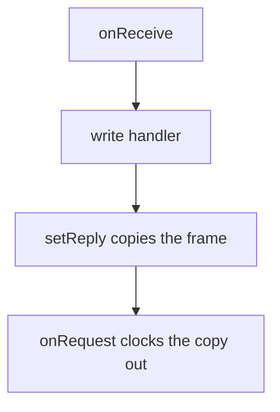

# Slave port

[Home](home.md) · Reference: [Slave port](reference/slave-port.md)

## Summary

`IModuleSlavePort` is the seam between the link and the bus.
`AvrTwi0Slave` is the TWI0 adapter. Desktop tests use
`FakeModuleSlavePort`. The fake's `deliver` calls the same handler the
driver's receive callback calls.

## Where it sits

`main.cpp` constructs `AvrTwi0Slave` with `SDA_PIN` and `SCL_PIN` and
passes it to `ModuleLink`. The link calls `enable`, `disable`,
`setAddress`, and `setReply`. The driver calls the link back on a
master write. Tests construct the fake in place of the driver.

## What it creates

```text
IModuleSlavePort
  AvrTwi0Slave          Wire on TWI0, alternate pins
  FakeModuleSlavePort   records calls
```

Wire's callbacks are plain function pointers, so one driver instance
is the active slave. That instance attaches one protocol handler.

## One update

The sketch does not call the driver. One transaction is a master
write, then the repeated-start read.



`setAddress` writes `TWI0.SADDR` from the stop callback and leaves the
bus up. `disable` calls `Wire.end()` and clears the pull-ups.

## What is stored, and who reads it

The driver keeps the handler, the reply bytes, the two pin numbers,
and whether TWI0 is enabled. The host clocks the reply out on the next
read. `TWI0.SADDR` is the address the peripheral acknowledges. The
fake keeps the same calls so a test can read them.

`SDA_PIN` and `SCL_PIN` name the motherboard-bus pins. `enable` passes
them to `Wire.pins` so the peripheral moves off PB0 and PB1.

## See also

- [Slave port reference](reference/slave-port.md) — `SADDR`, the alternate mux, what the fake records.
- [Module link](module-link.md)
- [Architecture](architecture.md)
